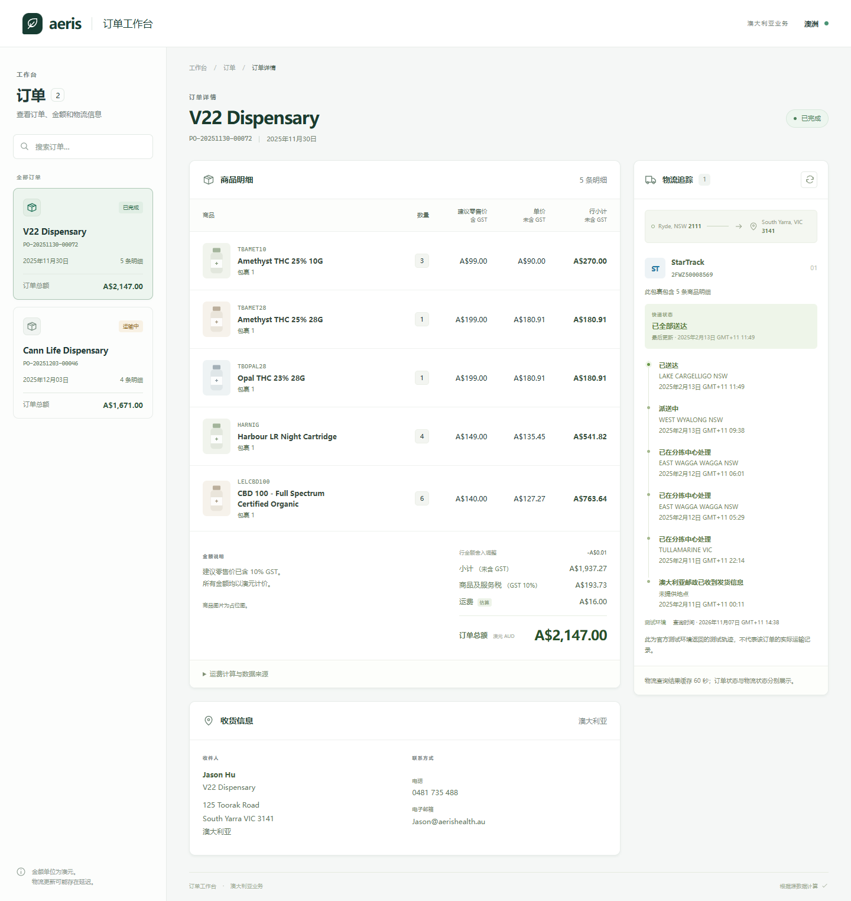
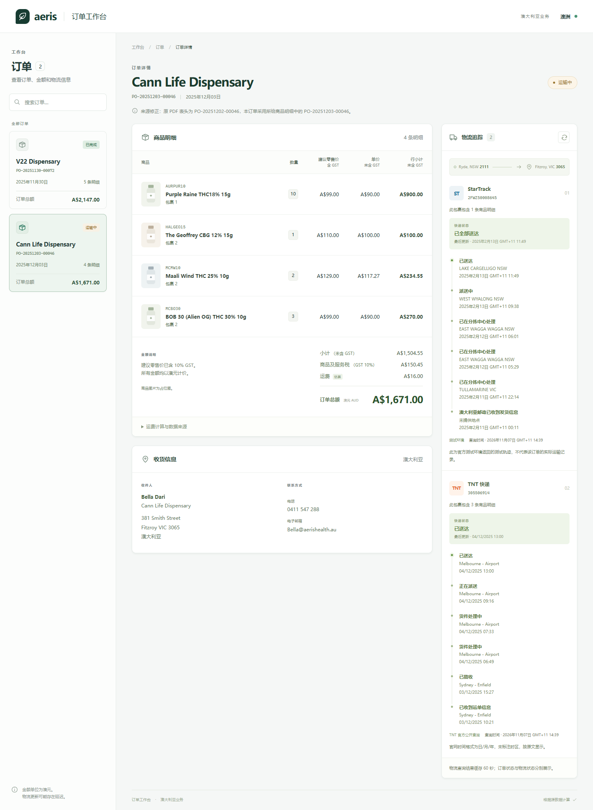
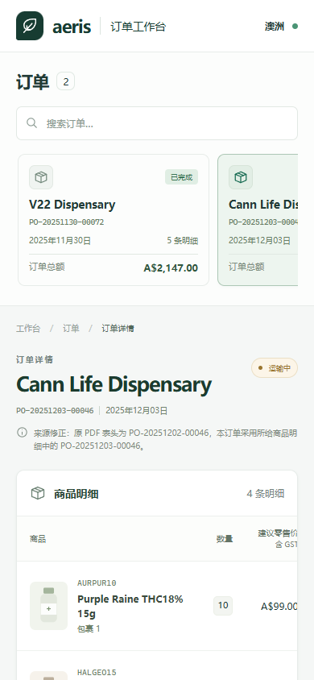

# Order Desk：订单详情、GST 与物流查询

一个面向澳大利亚业务场景的 React + TypeScript / FastAPI 小型全栈应用。读取订单 JSON，匹配真实查询得到的 SKU 商品数据，独立计算每张订单的未税小计、GST 和总额，并按包裹查询物流。界面与交付说明均使用中文；商品名、客户名、地址和承运商品牌保留来源原文。带时区的物流时间按澳大利亚悉尼显示；TNT 官网未标注时区的时间保留原文。金额以澳元计价。

## 交付状态

GitHub 仓库：[zhenglinniao/IT-2nd-Round-coding-Test](https://github.com/zhenglinniao/IT-2nd-Round-coding-Test)。评审者可从该仓库获取代码；运行及测试步骤见下文。

本 README 包含安装运行、依赖、输入结构、实现范围、测评难点、API 失败与回退、占位图和运费假设。外部接口验证记录见 [接口研究记录](docs/research.md)，检查详情见 [验收记录](docs/validation.md)。代码已公开推送；首次 [GitHub Actions 远程验收](https://github.com/zhenglinniao/IT-2nd-Round-coding-Test/actions/runs/42332984210)已通过后端测试、前端测试、生产构建和浏览器测试。后续提交的结果以对应 Actions 运行为准。

## 当前项目运行截图

以下为 2026-11-07 在本机实际启动当前项目后，由浏览器直接捕获的页面，未注入模拟物流响应。截图已开启自拟公式运费估算；商品图片为占位图。StarTrack 显示的是官方测试环境返回的轨迹，页面保留测试提示，不能作为订单实际送达证明；TNT 使用官方公开追踪结果。客户信息按题目原样展示。

### 桌面：订单、商品与金额

第一张订单，展示订单列表、五条商品明细、GST、舍入调整、运费估算及收货信息。



### 桌面：StarTrack 与 TNT 多包裹追踪

第二张订单，展示四条商品明细与两个独立包裹；订单状态和每个包裹的物流状态分别显示。



### 手机：390 × 844 视口

手机宽度下的页面顶部；向下滚动可继续查看商品、金额与物流。较宽商品表格在自身容器内横向滚动。



展示图片单独保存在 `docs/images/`，供 GitHub README 使用；整个 `output/` 仍被忽略，原始截图、翻译与面试讲解不会随该目录上传。截图反映捕获时状态，后续外部查询结果可能变化。

## 实现情况

- 两张原题订单、九条商品明细、三个包裹，订单列表支持搜索和切换。
- 商品名称、含税 RRP、重量和尺寸来自指定 SQL 查询工具，九个 SKU 全部匹配；没有虚构价格。商品图片为本地 SVG 中性药瓶占位图。
- Decimal 金额计算、明确的舍入规则、缺失商品时阻止生成误导性总额。
- Australia Post / StarTrack 服务端 Basic Auth 只读追踪适配，兼容多种事件结构，支持 60 秒缓存及每分钟 10 次本地限流。
- TNT 澳大利亚官方公开追踪，校验运单号、读取历史事件，已知状态以中文展示，无需配置 TNT 账号密码。
- 运费公式估算，按包裹计费、按订单汇总，界面明确标注“估算”。
- 独立物流加载、刷新、超时/权限/空结果/异常响应提示，物流故障不会影响订单详情。
- 桌面和手机布局、中文需求记录、自动测试及 GitHub Actions 检查配置。

**接口验证：** 经用户明确授权，已使用 HTML 补充版的更新凭据接通 Australia Post / StarTrack 官方测试环境。两条订单运单和四条 FAQ 测试运单均返回 HTTP 200，并返回与请求一致的运单号。六次返回的事件内容和时间相同，页面明确标注为测试轨迹，不代表实际订单的运输记录。原 PDF 凭据曾返回 401，当前本地配置已切换为更新凭据。

**TNT：** 官方公开追踪已接入，题目运单 `305506914` 当前返回六条事件，最新为 2025-12-04 13:00 已送达；官网时间未标时区，保留原文。国内 UAT 凭据现已在专用 RTTNet 报价入口验证成功，样例包裹返回五项 AUD 报价，错误密码及无效地区对照分别返回 XML 码 `004`、`590`。专用 Weblinking 追踪凭据仍未确认，生产 RTT 未验证。样例报价不参与订单计费，TNT 运费仍为 A$0.00。详情见 [接口研究记录](docs/research.md)。

## 技术栈与依赖

| 层次 | 依赖及用途 | 安装依据 |
| --- | --- | --- |
| 后端运行环境 | Python 3.12；FastAPI 提供 API，Uvicorn 运行服务 | `backend/requirements-lock.txt` |
| 数据与外部查询 | Pydantic 校验结构，httpx 查询物流，python-dotenv 读取配置；金额使用 Python 标准库 Decimal | 同上，包含直接和传递依赖 |
| 前端 | React 19、TypeScript 5.9、Vite 7 | `frontend/package.json` 和 `frontend/package-lock.json` |
| 后端测试 | pytest，配合 httpx MockTransport 隔离外部服务 | 后端锁定文件已包含测试依赖 |
| 前端测试与格式 | Vitest、Testing Library、jsdom、Prettier | `npm ci` 安装 |
| 浏览器测试 | Playwright，使用已安装 Edge 或单独安装 Chromium | 运行方法见“测试” |

Node.js 要求 22.12+，已使用 Node.js 24 进行验收。首次安装后端使用锁定文件，前端使用 `npm ci`，以复现已验收依赖；直接依赖清单另见 `backend/requirements.txt` 和 `backend/requirements-dev.txt`。本项目不需要数据库、Redis 或 Docker，订单与商品从本地 JSON 读取。

## 本地启动

需要 Python 3.12 和 Node.js 22.12+（本次使用 Node.js 24 验证）。先将终端工作目录切换到克隆后的项目根目录，即同时包含 `README.md`、`backend` 和 `frontend` 的目录。Windows 的 PowerShell、命令提示符（cmd）和 macOS/Linux 的 Bash/Zsh 使用不同语法，请选择对应小节，不要混用。

验证范围：Windows 已在本机运行，Linux 已通过 GitHub Actions 的安装、测试和构建；macOS 提供对应路径及 Shell 命令，尚未做真机验收。WSL 按 Linux 处理，使用独立的 Linux 虚拟环境，不复用 Windows 的 `.venv`；Windows Git Bash 不等于 WSL，本文 Windows 用户优先选择 PowerShell 或 cmd。

**首次安装与日常启动是两件事。** 创建虚拟环境、安装依赖和复制配置通常只需做一次；新电脑、重新克隆或依赖锁定文件更新后需要重新安装对应依赖。已有 `.env` 时保留账号配置。下面均直接调用虚拟环境中的 Python，不需要先执行 `Activate.ps1` 或激活环境。

### Windows：PowerShell / VS Code 的 PowerShell 终端

首次安装，在项目根目录逐行执行：

```powershell
python -m venv .venv
.\.venv\Scripts\python.exe -m pip install -r backend/requirements-lock.txt
cd frontend
npm.cmd ci
cd ..
if (!(Test-Path .env)) { Copy-Item .env.example .env }
```

如果 `python` 命令不可用，但已经安装 Windows Python Launcher，可将第一行改为 `py -3.12 -m venv .venv`。Python 和 Node.js 安装后需能从当前终端找到，修改 PATH 后重新打开终端。

日常启动，回到项目根目录后执行下面的通用方式：

```powershell
cd frontend
npm.cmd run build
cd ..
.\.venv\Scripts\python.exe -m uvicorn backend.app.main:app --host 127.0.0.1 --port 8000
```

PowerShell 执行 `npm` / `npx` 时可能优先选择 `npm.ps1` / `npx.ps1`，被脚本执行策略拦截，出现 `PSSecurityException`、`UnauthorizedAccess` 或“在此系统上禁止运行脚本”。因此本 README 的 Windows 命令显式使用 `npm.cmd` / `npx.cmd`。上面的直接启动方式也不执行 `.ps1` 文件，适用于 `start.ps1` 被拦截的情况。

如果当前 PowerShell 已允许执行本地脚本，也可以用快捷方式代替上面的日常启动命令：

```powershell
.\scripts\start.ps1
```

该脚本内部使用 `npm.cmd`，先构建前端再启动后端，但不会安装依赖。若脚本仍被执行策略拦截，使用前面的通用方式即可。

### Windows：命令提示符（cmd）

在终端选择“命令提示符”，或打开 cmd 后进入项目根目录。首次安装：

```bat
python -m venv .venv
.venv\Scripts\python.exe -m pip install -r backend\requirements-lock.txt
cd frontend
npm.cmd ci
cd ..
if not exist .env copy .env.example .env
```

日常启动，在项目根目录执行：

```bat
cd frontend
npm.cmd run build
cd ..
.venv\Scripts\python.exe -m uvicorn backend.app.main:app --host 127.0.0.1 --port 8000
```

cmd 不使用 PowerShell 的 `Test-Path`、`Copy-Item` 或 `$env:` 语法，也不直接运行 `start.ps1`。

### macOS / Linux：Bash 或 Zsh

确认 `python3 --version` 对应所需 Python 版本，`node --version` 满足 Node.js 要求。首次安装，在项目根目录执行：

```bash
python3 -m venv .venv
.venv/bin/python -m pip install -r backend/requirements-lock.txt
cd frontend
npm ci
cd ..
if [ ! -f .env ]; then cp .env.example .env; fi
```

日常启动，在项目根目录执行：

```bash
cd frontend
npm run build
cd ..
.venv/bin/python -m uvicorn backend.app.main:app --host 127.0.0.1 --port 8000
```

macOS/Linux 使用 `npm`、`npx` 和 `.venv/bin/python`；不使用 Windows 的 `.cmd`、`Scripts\python.exe` 或 PowerShell 启动脚本。若 Linux 创建虚拟环境时提示缺少 `venv` / `ensurepip`，需先安装发行版中对应 Python 版本的 venv 组件，再重试。

### 配置、访问地址与端口

首次安装后编辑 `.env`，填入有效的 Australia Post / StarTrack 测试凭据。留空时仅对应承运商显示未配置，订单、商品和计算仍可使用；TNT 公开追踪默认独立启用。已有 `.env` 时按配置表补充所需变量，不要用示例覆盖账号。

运费估算是可选项，示例默认为 `false`。设 `SHIPPING_ESTIMATE_ENABLED=true` 可复现下方含运费的演示总额；关闭时两张订单总额分别为 A$2,131.00 和 A$1,655.00。本次本地演示已开启。

启动后访问 [本地应用](http://127.0.0.1:8000) 和 [API 文档](http://127.0.0.1:8000/docs)。FastAPI 同源提供构建后的页面和 API，保持终端运行，按 Ctrl+C 停止。

若 8000 端口被占用，将 uvicorn 命令末尾改为 `--port 8002`，然后访问 `http://127.0.0.1:8002`。允许执行脚本的 Windows PowerShell 也可以用 `.\scripts\start.ps1 -Port 8002`。修改前端后需重新构建；仅重启未改动的项目时，可以直接运行对应系统的 uvicorn 命令，复用已有构建。

### 前端开发模式

先在一个终端启动后端。另开一个终端，在项目根目录进入 `frontend` 后启动 Vite：

Windows PowerShell 或 cmd：

```powershell
cd frontend
npm.cmd run dev
```

macOS/Linux 在 `frontend` 目录执行 `npm run dev`。访问 Vite 输出的地址（通常为 `http://127.0.0.1:5173`），该模式支持前端热更新。

Vite 将 `/api` 代理到本机 8000 端口；后端改用其他端口时需同步修改 `frontend/vite.config.ts` 中的代理地址。此开发模式与前面构建后由 FastAPI 提供页面的方式分别使用，不需要同时执行 `npm run preview`。

## 配置

将根目录的 `.env.example` 复制为 `.env`，按需填写；示例包含注释和公开默认值，不含真实凭据。配置仅在服务器使用，不能加 `VITE_` 前缀。系统或当前终端中已存在的同名环境变量优先于 `.env`，修改后需重启后端。

| 变量 | 未设置时的默认值 | 用途与填写边界 |
| --- | --- | --- |
| `AUSPOST_API_KEY` / `AUSPOST_API_SECRET` | 空 | Basic Auth 用户名和密码；与所查询承运商账号一并配置 |
| `AUSPOST_STARTRACK_ACCOUNT` | 空 | StarTrack Account-Number，按字符串填写并保留前导零 |
| `AUSPOST_POST_ACCOUNT` | 空 | Australia Post Account-Number；只查询 StarTrack 时可留空 |
| `AUSPOST_BASE_URL` | `https://digitalapi.auspost.com.au/test/shipping/v1` | 留空也使用默认值；生产基址为 `https://digitalapi.auspost.com.au/shipping/v1`，需相应权限。仅接受官方 HTTPS 主机及上述路径 |
| `TNT_TRACKING_ENABLED` | `true` | 启用 TNT 官方公开追踪；`false` 或空值关闭，不影响其他承运商 |
| `TNT_WEBLINKING_USERNAME` / `TNT_WEBLINKING_PASSWORD` | 空 | 附件的 Secured Weblinking 凭据，仅供服务端手动诊断；未验证专用追踪 API，不用于国内 UAT |
| `TNT_UAT_USERNAME` / `TNT_UAT_PASSWORD` / `TNT_UAT_ACCOUNT` | 空 | 国内 UAT 凭据，已通过专用 RTTNet 样例报价验证；不能与 Weblinking 凭据混用 |
| `SHIPPING_ESTIMATE_ENABLED` | `false` | 仅 `true` 启用本项目自拟的演示运费公式；`false` 或空值关闭 |
| `DATA_DIR` | 项目根目录下的 `data` | 留空也使用默认目录；自定义目录需含 `orders.json` 和 `products.json`，建议绝对路径 |

TNT 公开追踪默认启用，可用 `TNT_TRACKING_ENABLED=false` 关闭；仅支持 9 位数字的国内运单号。TNT 不使用 Australia Post 凭据，也不需要填写附件中的 TNT 密码。修改数据文件或服务器环境变量后需要重启后端；前端资源变更后重新构建。

两组 TNT 凭据通过上述五个环境变量在服务器端加载，配置对象的字符串表示隐藏凭据。它们不提供给前端，也不自动用于公开追踪。手动核验命令见下方：门户检查与 RTT UAT 报价使用不同命令、不同协议，不以门户登录结果判断专用 API 是否可用。

布尔开关不区分大小写，但只有 `true` 表示开启，`1`、`yes` 等值不生效。示例中的运费开关为 `false`，TNT 开关为 `true`。如需完全不访问外部物流，可清空邮政凭据并设置 `TNT_TRACKING_ENABLED=false`。

## 数据来源与结构

题目原文件放在本地 `IT 2nd Round coding Test` 文件夹，其中包含个人资料及测试凭据，整个目录已排除 Git 提交。`SQL.url` 是原查询链接的替换地址。

实际查询工具的表名是 `product_list`，字段是 `SKU`，不能照抄示例中的 `sku` 表和 `sku_code` 列。使用以下查询取得了九条记录：

```sql
SELECT * FROM product_list
WHERE SKU IN ('TBAMET10','TBAMET28','TBOPAL28','AURPUR10',
              'HARNIG','LELCBD100','HALGEO15','MCMW10','MCBO30');
```

`data/sku-source.json` 保留真实查询结果的相关字段摘录及查询记录；`products.json` 是规范化数据。重新导入可执行：

```powershell
.\.venv\Scripts\python.exe -m backend.import_products data/sku-source.json
```

导入器接受 `{ "rows": [...] }` 或直接的行数组。按显式单位转换：g → kg、mm → cm、mm³ → m³；未知单位拒绝导入，不自行猜测。原始 `Volumetric_GrossWeight` 未用作实际重量，公式按实际尺寸重新推导体积重量。

订单文件是数组，下面为输入结构示例（虚构地址和商品，不是默认订单）：

```json
[
  {
    "id": "EXAMPLE-001",
    "date": "2026-11-06",
    "status": "In Transit",
    "customer": {
      "company": "Example Pharmacy", "name": "Example Customer",
      "phone": "", "email": "",
      "address": {"line1": "42 Example Street", "suburb": "Sydney", "state": "NSW", "postcode": "2000", "country": "AU"}
    },
    "shipments": [{"id": "parcel-1", "carrier": "startrack", "tracking_number": "EXAMPLE123"}],
    "items": [{"id": "line-1", "sku": "EXAMPLE-SKU", "quantity": 2, "shipment_id": "parcel-1"}]
  }
]
```

对应商品文件也是数组：

```json
[
  {"sku":"EXAMPLE-SKU","name":"Example product","rrp":"22.00","weight_kg":"0.2","length_cm":"10","width_cm":"5","height_cm":"5","volume_m3":null}
]
```

字段边界：

- 订单号、商品 SKU 在各自文件中唯一；每个订单内明细 ID、包裹 ID 唯一。
- 同一 SKU 可以有多条明细，不自动合并或丢弃；同一包裹可包含多条明细。
- 数量为 1–1,000,000 的整数，布尔值、小数和数字字符串均不接受。
- RRP 为非负、有限、最多两位小数的 AUD 金额，支持零价；上限 A$1,000,000。
- 重量和尺寸为正数，可缺失；缺失不影响商品金额，只影响运费估算。
- 承运商仅支持 `startrack`、`auspost` 和 `tnt`；包裹关联必须有效，不接受无明细的包裹。
- 邮编为四位字符串；日期为 ISO 日期。状态作为来源订单状态展示，不由追踪 API 自动覆盖。
- 缺失/无效商品时保留明细，订单金额标为不完整；单张订单结构无效时在列表显示问题，其他有效订单仍可使用。
- 损坏文件或重复全局主键属于整体数据错误，API 返回 503 和可定位提示；健康接口仍存活。空订单数组是合法输入。

## 测评难点与处理方式

| 难点 | 处理方式与验证 |
| --- | --- |
| PDF、HTML 补充版和示例数据存在不一致 | 以原 PDF 为需求基础，显式记录订单号及 GST 假设；不将 AI 整合版自动视为覆盖原题的依据 |
| 示例 SQL 与真实查询工具字段不同 | 核实真实表 `product_list` 和字段 `SKU`，保留九个 SKU 的来源摘录，通过导入器规范化单位 |
| 含税 RRP、未税金额与逐行舍入可能重复计税或差一分钱 | 使用 Decimal 从未舍入原值汇总，订单层舍入，单列行金额舍入调整；以两张订单金额及边界测试验证 |
| 同一订单有多个承运商及包裹 | 用 `shipment_id` 关联明细，订单状态与每包裹物流状态分开；一个接口失败不清空其他包裹或订单金额 |
| 原始邮政凭据失败，而官方测试数据也不代表真实运输 | 区分认证失败和业务状态；验证更新凭据后明确展示 testbed 标识，不将测试轨迹作为订单真实运输记录 |
| TNT 摘要没有里程碑，但历史详情存在事件 | 读取官方历史页并匹配运单号、表头及允许的跳转路径；不根据页面固定阶段标签推断已送达 |
| TNT 时间不含时区、商品重量和尺寸单位不同 | 时间保留原文且注明时区未知；商品按显式单位转换，未知单位拒绝导入 |
| 外部接口不稳定会影响演示和测试 | 物流独立加载，统一故障状态，缓存及限流；自动测试使用隔离响应，真实接口另行只读验收 |

这些处理限定于当前测评规模。缓存和查询锁位于单进程内，不能直接充当多实例分布式限流；TNT 页面适配也需要随官网结构变化维护。

## 金额与需求冲突处理

原始 PDF 是需求基础，HTML 是 AI 辅助整合与 FAQ，不自动覆盖原题。两处冲突采用以下明确假设：

1. 原 PDF 第二张订单表头为 `PO-20251202-00046`，商品行均为 `PO-20251203-00046`；采用商品行订单号，并在页面保留修正说明。
2. 原题说明 SKU 价格含 GST，却又对含税小计加 10%。本项目采用补充说明的未税口径，避免重复加税。这是实施假设，不声称出题方已正式确认。

所有财务计算由后端 Decimal 完成，API 金额使用字符串；前端仅格式化显示。

```text
未税单价原值 = RRP / 1.10
未税行金额原值 = 未税单价原值 × 数量
未税订单小计原值 = 各行金额原值之和
展示未税小计 = ROUND_HALF_UP(未税订单小计原值, 2)
展示 GST = ROUND_HALF_UP(未税订单小计原值 × 10%, 2)
总额 = 展示未税小计 + 展示 GST + 运费
```

精度为 40 位；单价和行金额均显示两位，但后续计算不使用已舍入展示值。订单一展示行金额合计比汇总小计多 A$0.01，界面单列 `行金额舍入调整 = -A$0.01` 用于对账。订单二若从已舍入小计再次计算税额也会多一分钱，因此税额同样从未舍入原值计算。

| 订单 | 未税小计 | GST | 未估运费总额 | 本次公式运费 | 启用公式后总额 |
| --- | ---: | ---: | ---: | ---: | ---: |
| PO-20251130-00072 | 1,937.27 | 193.73 | 2,131.00 | 16.00 | 2,147.00 |
| PO-20251203-00046 | 1,504.55 | 150.45 | 1,655.00 | 16.00（TNT 部分 0.00） | 1,671.00 |

以上是测试期望值，业务代码没有按订单号或 SKU 硬编码这些结果。

## 运费估算边界

原始 `2026-06-IT-Interview-in-person.pdf` 第 3 页第 4 节“Shipment Fee (Bonus)”允许使用运费 API，或基于重量和体积自行制定合理假设/公式，并在 README 解释；未完成时可显示 A$0.00。**原题没有提供具体费率公式。** 以下是本项目自行设定的演示估算：基础费 A$8、每公斤 A$1.50、跨州附加费 A$5 和体积系数 250 都是实施假设，不是题目指定数值，也不是承运商真实费率。

```text
包裹实际重量 = Σ(单件 kg × 数量)
包裹总体积 = Σ(单件 m³ × 数量)
计费公斤 = ceil(max(实际重量, 总体积 × 250))
包裹费用 = A$8 + 计费公斤 × A$1.50 + 跨州附加 A$5
订单运费 = 包裹费用之和
```

发件邮编固定为题目指定的 2111，发件州 NSW，目的邮编来自订单。当前自拟公式只区分是否跨州，不根据邮编距离或偏远地区计算附加费。假设商品可合并装入对应包裹，不另加包装重量或空隙；体积系数 250 也是本项目的演示假设。公式结果作为本项目展示的运费金额，未额外计算运费税。

公式对 StarTrack / Australia Post 使用相同的演示参数，不调用承运商实时费率。包裹沿用输入文件的划分，不进行装箱优化或自动拆包；每个包裹仅收一次基础费、一次跨州费。计费重量在包裹汇总后向上取整到整公斤，不对每件商品分别进位。体积优先采用有效 `volume_m3`，否则用完整长宽高计算；所有尺寸和重量均为单件数据，按明细数量累计。不另计燃油、保险、签名、重派、偏远地区或最低消费等附加费用。

缺商品/重量/体积时该包裹为 A$0.00；TNT 订单报价尚未自动接入，费用也为 A$0.00（公开追踪及独立 RTT UAT 样例报价已验证）。样例包裹、服务选择与报价税额口径尚不能代替订单真实运费，不将样例最低价直接计入订单。订单可能包含部分估算加部分零费用，不表示完整最终承运商费用。

关闭估算时全部包裹按 A$0.00 展示；追踪接口成功或失败均不改变公式估算结果。金额完整与运费完整是两个概念：商品金额可完整，而订单仍含回退为零的运费包裹。API 的 `shipping.complete` 只有全部包裹均成功采用公式时才为 `true`，不能把回退零费用理解为承运商免运费。

## API 失败记录、回退与占位图

以下为 2026-11-06 的实际核验记录，详细结果见 [接口研究记录](docs/research.md)，不代表外部服务将持续返回相同结果。

| 情况 | 实际处理与回退 |
| --- | --- |
| 商品查询工具在终端 HTTPS 超时或 EOF；示例字段查询无匹配 | 通过浏览器核实真实表名与字段后取得九行数据，保存来源摘录；运行时读取本地数据，不因查询网站临时不可用而丢失商品 |
| 原始邮政凭据查询超时或 HTTP 401 | 显示超时或授权失败，不把失败当作“未发货”；订单详情和金额继续可用 |
| HTML 更新凭据成功，但多条运单返回相同测试轨迹 | 已验证 HTTP 200、请求运单号匹配和六条事件；明确标注官方测试环境，生产环境未验证 |
| TNT 摘要页提示没有 milestone 数据 | 继续查询官方历史详情，题目运单读取到六条事件；未使用固定进度标签或人工补造轨迹 |
| 网络失败、HTTP 429 / 5xx、异常格式、非法跳转或单号不匹配 | 返回对应包裹的故障状态和中文提示，不返回虚构送达事件；已发出的查询结果含错误均缓存 60 秒，不自动重试 |
| 商品未匹配或价格无效 | 保留明细并标注问题，总额为空而非默认为零；不会用占位商品价格参与计算 |
| 关闭运费估算、缺少估算条件或 TNT 尚无报价适配 | 相应包裹运费回退为 A$0.00，显示原因；不影响独立物流查询 |

商品没有可靠的图片来源，因此统一使用 `frontend/src/icons.tsx` 中 `ProductPlaceholder` 绘制的内联 SVG 中性药瓶占位图。它不请求远程图片、不代表商品实物或包装；页面有“商品图片为占位图”说明，并提供中文无障碍标签。商品名称、价格和重量来自真实查询数据，不由图片占位逻辑生成。

## API 与故障处理

| 接口 | 用途 |
| --- | --- |
| `GET /api/health` | 应用存活及数据就绪状态；不检查外部快递 |
| `GET /api/orders` | 订单摘要、完整性和计算金额 |
| `GET /api/orders/{id}` | 客户、商品明细、包裹、金额和运费依据 |
| `GET /api/orders/{id}/tracking` | 各包裹独立查询结果，局部失败不影响其他包裹 |

未知订单返回 404，无效订单返回 422，整体数据错误返回 503。物流查询接口以 HTTP 200 返回每个包裹的独立结果，当前状态如下：

| `query_state` | 含义 |
| --- | --- |
| `available` | 存在承运商返回的状态或历史轨迹 |
| `not_configured` | 邮政凭据不完整，或 TNT 查询开关关闭 |
| `unsupported_number` | 当前 TNT 入口不支持此运单号格式，未发送外部请求 |
| `not_found` / `unavailable` | 未找到匹配运单，或暂时没有可用轨迹 |
| `authentication_failed` | 上游返回 HTTP 401 / 403 |
| `rate_limited` | 达到本地查询额度，或上游返回 HTTP 429 |
| `timeout` / `network_error` | 上游查询超时或连接失败 |
| `upstream_error` / `invalid_response` | 上游服务异常、格式变化、非法跳转或结果不匹配 |

查询不自动重试；结果含错误状态也缓存 60 秒，同一运单的并发请求合并。缓存与每分钟最多 10 次查询的额度均保存在单个服务进程内，重启后清空；邮政与 TNT 共享本地额度，缓存命中不扣额度。一次 TNT 查询最多包含五个官方页面请求，整体限时 30 秒；前端请求超时为 45 秒。

响应包含 `environment`、`cached` 和 `fetched_at`，分别表示查询来源、是否命中缓存和本次查询时间。`testbed` 为邮政测试环境，`production` 为邮政生产环境，`tnt_public` 为 TNT 官方公开页面。`fetched_at` 不作为事件时间使用，Testbed 轨迹不能作为真实运输证明。

邮政事件的 `date` 和 `last_update` 仅接受带时区的 ISO 时间。TNT 官网未标时区，以上字段为 `null`，通过事件的 `date_text` 和包裹的 `last_update_text` 保留 `04/12/2025 13:00` 这样的日/月/年时间，不自行转换时区。

TNT 公开追踪适配器只执行查询和历史详情操作，校验运单号、历史表头及跳转目标；不根据摘要页的固定进度标签推断送达。另有独立 RTT UAT 样例报价验证器。专用 Weblinking 追踪、订单自动报价、制单、标签打印和订阅通知均未接入。

## 测试

Windows PowerShell，在项目根目录执行：

```powershell
.\.venv\Scripts\python.exe -m pytest
cd frontend
npm.cmd test
npm.cmd run build
```

执行后位于 `frontend` 目录。端到端测试使用独立 8001 端口，强制清空邮政凭据、关闭 TNT 外部查询并启用公式运费；部分用例在浏览器内注入隔离的模拟轨迹，不访问真实物流。先构建前端，确保 8001 端口空闲，再选择对应终端运行：

```powershell
# 使用已安装的 Microsoft Edge，无需额外浏览器下载
$env:PLAYWRIGHT_CHANNEL = 'msedge'
npm.cmd run test:e2e
```

Windows cmd 同样使用 `.venv\Scripts\python.exe`、`npm.cmd` 和 `npx.cmd`；若选择已安装 Edge，在 `frontend` 目录设置环境变量时改用 cmd 语法：

```bat
set "PLAYWRIGHT_CHANNEL=msedge"
npm.cmd run test:e2e
```

Windows PowerShell 没有 Edge 时，可安装 Playwright 自带 Chromium 后使用默认通道，在 `frontend` 目录运行：

```powershell
Remove-Item Env:PLAYWRIGHT_CHANNEL -ErrorAction SilentlyContinue
npx.cmd playwright install chromium
npm.cmd run test:e2e
```

cmd 对应的清除变量命令为 `set "PLAYWRIGHT_CHANNEL="`，随后执行 `npx.cmd playwright install chromium` 和 `npm.cmd run test:e2e`。

macOS/Linux 的 Bash/Zsh，在项目根目录执行：

```bash
.venv/bin/python -m pytest
cd frontend
npm test
npm run build
unset PLAYWRIGHT_CHANNEL
npx playwright install chromium
npm run test:e2e
```

Linux 若缺少 Chromium 的系统依赖，可将安装浏览器一行替换为 `npx playwright install --with-deps chromium`（可能需要系统包安装权限，GitHub Actions 使用此方式）。自动测试不需要真实快递凭据。以下商品导入、烟雾检查和 TNT 诊断示例中的 Windows Python 路径，在 macOS/Linux 均替换为 `.venv/bin/python`，并从项目根目录执行。

后端 117 项测试已通过，包括 RTT 双重编码、XML 报价、认证错误、业务校验、非法 XML、异常价格及跳转限制；此前 9 项前端测试、6 项端到端测试及生产构建均通过，本次未修改界面或订单计费。其余覆盖金额、舍入、输入校验、数据隔离、单位转换、运费、物流故障、缓存及门户诊断。完整结果见 [验收记录](docs/validation.md)。

真实物流烟雾检查在项目根目录运行，会遍历订单中的三个包裹。邮政需有效凭据，TNT 需开关为 `true`；该命令访问实际外部服务，不属于离线自动测试。输出仅包含规范化状态、查询来源和时间等摘要，不打印凭据或原始响应。TNT 因官网未标时区，输出的 `last_update` 为空，可在页面查看原始事件时间。

```powershell
.\.venv\Scripts\python.exe -m backend.smoke_tracking
```

TNT 账号的手动诊断（在根目录运行，访问外部网络，自动测试不会执行）：

```powershell
.\.venv\Scripts\python.exe -m backend.tnt_diagnostics --service all
# 也可选择 --service weblinking 或 --service uat，单独核验一组。
```

此命令只核验两组凭据与 TNT Online 门户的兼容性，**不是专用 Weblinking 或 RTT API 验证**。它读取防伪令牌后 POST 到固定官方 HTTPS 登录地址，两组使用独立会话，不跟随跳转、不创建运单、不自动重试，只输出脱敏结果。`portal_rejected` 表示门户拒绝，不能断言专用 API 凭据失效；`authentication_unconfirmed` 表示未获得认证成功证据；所有结果的 `account_api_verified` 均为 `false`。未配置时不发送请求。

2026-11-07 专用 API 复核已纠正先前判断：旧 `.asp` 地址的 GET 404 和门户拒绝都不足以判断 RTT 可用性。正确的 UAT 报价入口为 `https://uat.tntexpress.com.au/rttnet/inputrequest.aspx`，使用表单 POST：`Username`、`Password`、`Version=2`、`XMLRequest`。XMLRequest 先 URL 编码，再由表单编码一次；密码不进入 URL。

```powershell
# 日期按实际验证时间更新，建议选择未来工作日。
.\.venv\Scripts\python.exe -m backend.tnt_diagnostics --service rtt --shipping-date 2026-11-09
# 可选对照：共三次只读报价请求，包含一次故意错误密码、一次无效地区。
.\.venv\Scripts\python.exe -m backend.tnt_diagnostics --service rtt --shipping-date 2026-11-09 --rtt-controls
```

样例为 `GLADESVILLE NSW 2111 → FITZROY VIC 3065`，一件、1 kg、10×10×10 cm、非危险品、寄件方付款。验证时返回五种 AUD 报价；错误密码在 HTTP 200 中返回 XML 码 `004`，把寄件区改为 `RYDE/2111` 返回业务校验码 `590`。因此不能只看 HTTP 状态判断成功。题目中的 Ryde/2111 组合需业务确认，不能无说明地用于实时下单。此命令不创建运单、不选择订单服务、不更新金额；RTT URL 固定为官方 UAT，不向生产环境发送 UAT 凭据。

当前可确认国内 UAT 账号和 RTT 样例报价可用；专用 Weblinking 追踪凭据仍未验证，生产报价也未验证。公开追踪独立可用。复核详情及结果矩阵见 [接口研究记录](docs/research.md)。

## 常见问题

| 现象 | 排查方式 |
| --- | --- |
| PowerShell 执行 npm / npx 提示禁止运行脚本 | 使用 `npm.cmd` / `npx.cmd`，显式调用 Windows 命令版本，避免命中 `npm.ps1` / `npx.ps1` |
| `start.ps1` 提示 `PSSecurityException` 或 `UnauthorizedAccess` | 使用“Windows：PowerShell”小节中的 `npm.cmd run build` 和虚拟环境 Python 直接启动方式 |
| 无法运行 `Activate.ps1` | 本文命令不需要激活虚拟环境，直接运行 `.\.venv\Scripts\python.exe`；macOS/Linux 使用 `.venv/bin/python` |
| StarTrack 提示 HTTP 401 / 403 | 检查 API Key、Secret、对应 Account-Number 及测试/生产环境是否匹配；账号保留前导零。更新配置后重启服务 |
| TNT 显示未启用 | 将 `TNT_TRACKING_ENABLED` 设为 `true` 并重启；同时检查当前终端是否有同名环境变量覆盖 `.env` |
| TNT 查询格式异常 | 可能是官网页面变化或运单结果不匹配；查看查询提示，不将固定进度标签作为真实状态 |
| 点击刷新仍是旧结果或错误 | 成功与错误结果均缓存 60 秒，稍后再刷新；查询时间不等于物流事件时间 |
| 总额比演示少 A$16.00 | 示例默认关闭运费估算；需要相同演示口径时设 `SHIPPING_ESTIMATE_ENABLED=true` 后重启 |
| 页面未更新 | 前端修改后重新构建并刷新；后端或 `.env` 修改后重启。`npm run dev` 提供开发时热更新 |
| 订单接口返回 503 | 检查 `DATA_DIR`、两个 JSON 文件的结构和错误提示；`/api/health` 的 `data_ready` 可用于检查数据就绪状态 |
| 端到端测试提示找不到浏览器 | 选择已安装的 Edge 通道，或安装 Playwright Chromium；命令见上方 |

## 项目目录

```text
backend/app/                 API、配置、数据校验、金额计算与快递适配
backend/app/tnt.py           TNT 官方公开追踪适配器
backend/tests/               后端测试
backend/import_products.py   商品导入工具
backend/smoke_tracking.py    真实物流只读烟雾检查
backend/tnt_diagnostics.py   门户兼容性诊断与独立 RTT UAT 样例报价验证
backend/app/tnt_rtt.py       专用 RTTNet UAT 只读样例报价与 XML 校验
frontend/src/                中文 React 界面
frontend/e2e/                隔离的端到端测试
data/                       订单、商品及商品来源摘录
docs/                       开发计划、接口研究和验收记录
scripts/start.ps1           Windows 构建并启动脚本
.env.example                带注释的配置模板，不含真实凭据
.github/workflows/          GitHub Actions 检查配置
```

## 提交与后续边界

`.gitignore` 排除 `.env`、整个 `IT 2nd Round coding Test/` 原题目录、整个 `output/` 输出目录、原始下载目录、依赖、构建产物及本地截图。题目翻译、PDF 和截图等本地产物不随仓库交付。测试凭据仅用于测评测试，通过环境变量在服务器端加载，不提交 GitHub，也不放入前端源代码或构建资源；`.env.example` 仅含空白凭据字段和公开默认值。仓库中仅保留必要的题目订单数据和商品字段。

仓库交付代码与说明，未进行公网应用部署。应用是面试演示范围，不包含登录、权限、多用户隔离、持久数据库、订单编辑、付款和发货创建；运行时仅监听本机，不适合未经补充安全设计直接公网开放。
